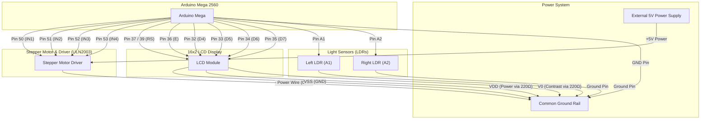

# Solar Panel Sun Tracking System

An automated single-axis solar panel tracking system built with Arduino, a stepper motor, an LCD display, and dual Light Dependent Resistors (LDRs). The system optimizes solar panel orientation by continuously adjusting towards the brightest light source using a Hill-Climbing (Gradient Ascent) algorithm.

---

## Features

- **Hill-Climbing Tracking Algorithm**: Dynamically tracks maximum light intensity by computing the sensor gradient.
- **Deadband Thresholding**: Ignores small sensor fluctuations (`threshold = 15`) to eliminate jitter and continuous hunting/oscillation.
- **Hardware Travel Limits**: Software-bounded sweep range (`±1024` steps / half-rotation) to prevent cable entanglement.
- **Real-Time LCD Diagnostics**: 16x2 LCD shows current operational state (`Climbing: RIGHT`, `Climbing: LEFT`, `Peak Locked`) and raw LDR readings.
- **Power Conservation**: Disables motor coils upon reaching the light peak to minimize energy consumption.

---

## Wiring Diagram

The visual source file can be edited in Draw.io / diagrams.net: [wiring diagram.drawio](file:///d:/Coding%20project/Ardunio%20projects/Solar%20Pannl%20Sun%20tracking/wiring%20diagram.drawio).

### Schematic Overview



### Detailed Pin & Wire Mapping

| Subsystem | Component Pin | Arduino Mega Pin / Rail | Description / Wire Note |
| :--- | :--- | :--- | :--- |
| **Stepper Motor** | IN1 | Pin 50 | Stepper Phase 1 |
| | IN2 | Pin 51 | Stepper Phase 2 |
| | IN3 | Pin 52 | Stepper Phase 3 |
| | IN4 | Pin 53 | Stepper Phase 4 |
| | VCC (+) | External +5V Power Supply | High current supply for stepper driver |
| | GND (-) | Common Ground Rail | Common return path |
| **16x2 LCD Display** | RS | Pin 37 *(drawn as 39 in diagram)* | Register Select |
| | Enable (E) | Pin 36 | Enable signal |
| | D4 | Pin 32 *(or Pin 35 per code)* | Data pin 4 |
| | D5 | Pin 33 *(or Pin 34 per code)* | Data pin 5 |
| | D6 | Pin 34 *(or Pin 33 per code)* | Data pin 6 |
| | D7 | Pin 35 *(or Pin 32 per code)* | Data pin 7 |
| | VSS | Common Ground Rail | Ground |
| | VDD | Power Rail / Ground Rail | Via 220Ω resistor |
| | V0 | Common Ground Rail | Contrast control (via 220Ω resistor) |
| **Light Sensors** | Left LDR (Signal) | Analog Pin A1 | Voltage divider analog reading |
| | Left LDR (GND) | Common Ground Rail | Sensor ground reference |
| | Right LDR (Signal)| Analog Pin A2 | Voltage divider analog reading |
| | Right LDR (GND) | Common Ground Rail | Sensor ground reference |
| **Common Ground** | GND Pin | Common Ground Rail | Connects Arduino GND to shared rail |

---

## How the Hill-Climbing Algorithm Works

The tracking mechanism treats light intensity as a one-dimensional objective function over the panel's rotational axis.

```
       [Left LDR (A1)]   <--- Divider --->   [Right LDR (A2)]
                                 |
                          Sun / Light Source
```

### 1. Sampling (Objective Function)
Each loop iteration reads raw analog values (0–1023) from both photoresistors:
```cpp
int leftVal = analogRead(ldrLeftPin);
int rightVal = analogRead(ldrRightPin);
```

### 2. Gradient Calculation
The system calculates the directional error (gradient) between the two sensors:
$$\text{gradient} = \text{rightVal} - \text{leftVal}$$

### 3. Step Decision & Ascent
- **Right side brighter ($\text{gradient} > \text{threshold}$)**:
  Steps clockwise (`myStepper.step(1)`), increments `currentPosition`, and updates the display to `Climbing: RIGHT`.
- **Left side brighter ($\text{gradient} < -\text{threshold}$)**:
  Steps counter-clockwise (`myStepper.step(-1)`), decrements `currentPosition`, and updates the display to `Climbing: LEFT`.
- **Safety check**: Movement only occurs if `currentPosition` is within bounds (`-maxTravel < currentPosition < maxTravel`).

### 4. Convergence & Peak Locking
When $|\text{gradient}| \le \text{threshold}$:
- The differential light between sensors is negligible, meaning the panel is directly perpendicular to the light source.
- The state changes to `Peak Locked`.
- Stepper motor coils are de-energized to prevent overheating and conserve power while maintaining position.

---

## Getting Started

1. Wire your components according to the [Wiring Diagram](#wiring-diagram) and common ground rail.
2. Open [hill_climb_algo.cpp](file:///d:/Coding%20project/Ardunio%20projects/Solar%20Pannl%20Sun%20tracking/hill_climb_algo.cpp) in Arduino IDE or PlatformIO.
3. Select the Arduino Mega 2560 board and corresponding COM port.
4. Compile, upload, and monitor the LCD display for tracking status.
